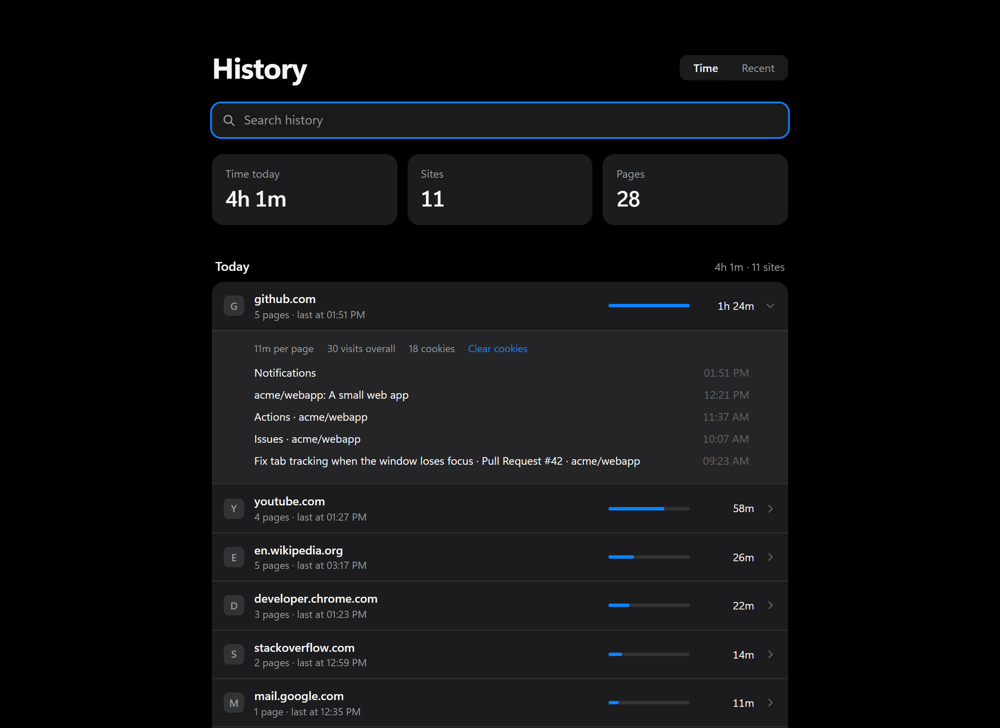
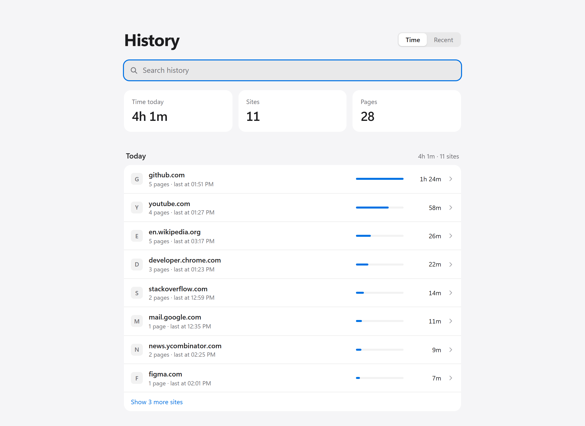
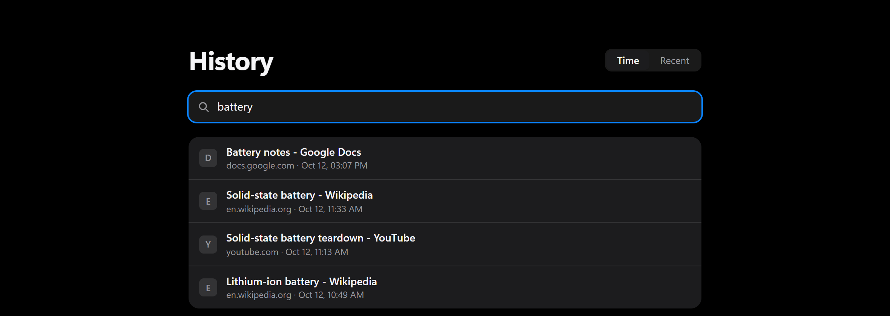

# Retrace

A cleaner history page for Chrome. Retrace replaces the page behind Ctrl+H with one that groups each day by site and shows how long you spent there.

## What it does

- **Days grouped by site.** One row per site instead of a long list of page titles, with the number of pages, the last visit and a bar for time spent.
- **Time spent.** Retrace records how long each site is in front of you. It stops when Chrome loses focus or the screen locks, and keeps counting while a video with sound is playing.
- **Details on demand.** Click a site to see its pages, its total visits and how many cookies it has stored. From there you can remove a page from history or clear the site's cookies.
- **Search.** Type in the bar, or press `/` to jump to it and Esc to clear.
- **Light and dark.** Follows your system theme. The page shows in English or French depending on Chrome's language.

| Light theme | Search |
| --- | --- |
|  |  |

The screenshots use demo data.

## Install

Retrace is not on the Chrome Web Store, so it is loaded by hand:

1. Download this repository (**Code**, then **Download ZIP**) and unzip it, or clone it.
2. Open `chrome://extensions` and turn on **Developer mode**.
3. Click **Load unpacked** and choose the folder.
4. Press Ctrl+H. Chrome may ask once whether to keep the new history page.

## Good to know

- Chrome does not store time spent, so Retrace starts counting on the day you install it. Until then, rows show visit counts instead.
- Chrome keeps about 90 days of history, and Retrace shows what Chrome has.
- Removing a page removes every visit to it, not only that day's.

## Privacy

Everything stays on your computer. Retrace has no server, no account and no analytics, and it makes no network requests.

| Permission | Why it is needed |
| --- | --- |
| `history` | Read and search your history, and remove pages from it |
| `tabs`, `idle`, `alarms` | Know which site is in front of you, to count time |
| `storage` | Save the time counts locally |
| `cookies` and access to all sites | Count a site's cookies and clear them when you ask |
| `favicon` | Show each site's icon |

## License

[MIT](LICENSE) © 2026 Yanis Arris
